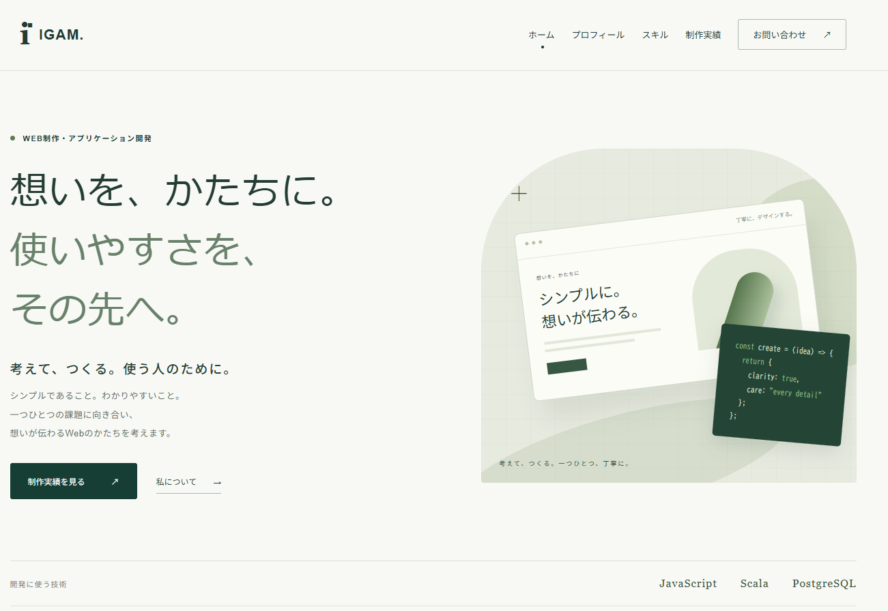

# IGAM's Portfolio

Scala.jsで作成した個人ポートフォリオサイトです。
プロフィール、学習している技術、制作実績を紹介しています。
**https://igam.dev**


## 技術スタック
| 分類 | 技術                                               |
|---|--------------------------------------------------|
| 言語 | Scala 3.10.0                                    |
| フロントエンド | Scala.js 1.22 / Laminar 18 / Waypoint 10（ルーティング） |
| ビルド | sbt 2.0 / Vite 4.5                               |
| CI/CD | GitHub Actions                                   |
| ホスティング | GitHub Pages（独自ドメイン: Cloudflare DNS）             |
| バックエンド（予定） | Play Framework 3 / PostgreSQL                    |


## 主な機能
- ホーム / プロフィール / スキル / 制作実績 / お問い合わせ の5ページ構成（SPA）
- 制作実績のカテゴリ絞り込み
- お問い合わせフォームの入力チェック（デモ）
- スマートフォン対応のレスポンシブデザインとハンバーガーメニュー

## 工夫した点
- **Lighthouse で全項目 100 点**（Performance / Accessibility / Best Practices / SEO）
- **GitHub Actions による自動デプロイ**
    - main への push で、ビルドから公開までを自動化
    - `frontend/` 配下の変更時のみ実行
- **SPA を GitHub Pages で公開するための対応**（404.html へのフォールバック）
- **共有時の見え方**: OGP / canonical を設定

## ディレクトリ構成
  ```
  .
  ├── frontend/   # Scala.js + Vite（公開中）
  ├── backend/    # Play Framework（開発予定）
  └── .github/workflows/deploy-frontend.yml
  ```

## ローカルで起動
```bash
  cd frontend
  npm ci
  sbt ~fastLinkJS   # 別ターミナルで
  npm run dev
  ```

詳しい手順は [frontend/README.md](frontend/README.md) を参照してください。

## 今後の予定

- [ ] Play Framework によるお問い合わせ API
- [ ] PostgreSQL での制作実績データ管理
- [ ] ルートの build.sbt でフロントエンドとバックエンドを統合

## 開発記録

| 日付 | 内容 |
  |---|---|
| 2026/10/30 | 開発開始 |
| 2026/11/01 | フロントエンドを GitHub Pages で公開、GitHub Actions による自動デプロイ |
| 2026/11/01 | 独自ドメイン igam.dev を取得・設定 |
